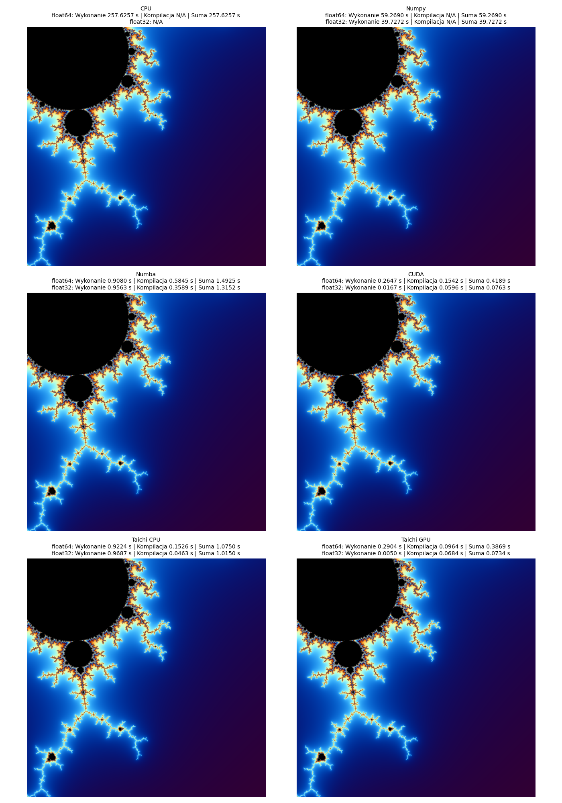

# Mandelbrot-in-Python

Ten sam fragment zbioru Mandelbrota (8000 × 8000 pikseli, 255 iteracji) policzony sześcioma sposobami w Pythonie: czysty Python, NumPy, Numba, Numba CUDA oraz Taichi na CPU i na GPU.
Notebook [`mandelbrot.ipynb`](mandelbrot.ipynb) liczy obraz każdą metodą, mierzy czas wykonania i czas kompilacji (JIT) i rysuje wyniki.



## Wyniki

Pomiar z notebooka, uruchomionego w kontenerze z tego repozytorium (CUDA 12.6, Python 3.12). Każda metoda (poza czystym Pythonem, który zawsze liczy w `float64`) jest policzona dwa razy: w podwójnej (`float64`) i pojedynczej (`float32`) precyzji.

| Metoda | Precyzja | Wykonanie [s] | Kompilacja [s] | Suma [s] | Przyspieszenie względem czystego Pythona (suma) |
|---|---|---:|---:|---:|---:|
| czysty Python (CPU) | float64 | 257,6257 | – | 257,6257 | 1× |
| NumPy | float64 | 59,2690 | – | 59,2690 | 4× |
| NumPy | float32 | 39,7272 | – | 39,7272 | 6× |
| Numba (`@njit(parallel=True)`) | float64 | 0,9080 | 0,5845 | 1,4925 | 173× |
| Numba (`@njit(parallel=True)`) | float32 | 0,9563 | 0,3589 | 1,3152 | 196× |
| Numba CUDA | float64 | 0,2647 | 0,1542 | 0,4189 | 615× |
| Numba CUDA | float32 | 0,0167 | 0,0596 | 0,0763 | 3377× |
| Taichi (CPU) | float64 | 0,9224 | 0,1526 | 1,0750 | 240× |
| Taichi (CPU) | float32 | 0,9687 | 0,0463 | 1,0150 | 254× |
| Taichi (GPU, CUDA) | float64 | 0,2904 | 0,0964 | 0,3869 | 666× |
| Taichi (GPU, CUDA) | float32 | 0,0050 | 0,0684 | 0,0734 | 3510× |

Sprzęt: Intel Core i7-12700F (20 wątków), NVIDIA GeForce RTX 3060 Ti (8 GB), 32 GB RAM.

Co z tego wynika:

- **Na GPU precyzja robi ogromną różnicę.** Jądro CUDA w `float32` jest ok. 16× szybsze niż w `float64`, a Taichi GPU ok. 58×, bo karty konsumenckie mają `float64` o rząd wielkości wolniejsze niż `float32`. Na CPU `float32` nic nie daje (Numba, Taichi) albo daje do ok. 1,5× (NumPy, mniej danych w pamięci).
- **`float32` wystarcza przy tym powiększeniu, ale nie jest identyczny.** Szerokość 0,4 przez 8000 pikseli to krok ok. 5·10⁻⁵, a ulp `float32` przy wartościach ok. 1 to ok. 1,2·10⁻⁷. Na wykresie nie widać różnicy, ale ok. 0,23–0,26% pikseli (głównie na granicy zbioru, gdzie iteracje są chaotyczne) różni się od wersji `float64` o więcej niż jedną iterację. Przy głębszym zoomie `float32` przestaje wystarczać.
- **Różnica między Taichi GPU a Numba CUDA w `float32`** (5 ms wobec 17 ms) to wynik pomiaru, którego nie wyjaśniałem. Jedna z możliwych przyczyn to domyślne ustawienia kompilatora Taichi (np. szybsza matematyka), ale tego nie sprawdzałem.

Uwagi do pomiaru:

- „Kompilacja” to różnica między pierwszym wywołaniem (kompilacja JIT plus wykonanie) a drugim (samo wykonanie), tak samo dla Numby, CUDA i Taichi. „Suma” to zatem czas pierwszego wywołania. Na GPU zawiera też inne jednorazowe koszty pierwszego uruchomienia (np. ładowanie modułu na kartę), więc to raczej „narzut pierwszego wywołania” niż sama kompilacja.
- Precyzja jest wymuszana jawnie (`float32(...)` w Numbie i CUDA, `default_fp` w Taichi, `dtype` w NumPy), żeby literały typu `0.0` nie awansowały obliczeń po cichu do `float64`. Współrzędne piksela są liczone w `float64` i dopiero rzutowane na docelowy typ. Wynik jest zawsze zapisywany jako `float32`.
- Czasy CUDA i Taichi GPU dotyczą samego jądra obliczeniowego (z synchronizacją), bez kopiowania wyniku z karty do pamięci RAM. Czas czystego Pythona nie obejmuje konwersji listy do tablicy NumPy.
- Pojedynczy przebieg na jednym komputerze, więc traktuj liczby jako rząd wielkości, a nie dokładny benchmark.
- Notebook sam zapisuje wykres (obrazy z `float64`, czasy obu precyzji w tytułach) do `wynik.png` i drukuje tabelę z odsetkiem pikseli różniących się między precyzjami.

## Uruchomienie

Potrzebne są Docker z obsługą GPU NVIDIA ([NVIDIA Container Toolkit](https://docs.nvidia.com/datacenter/cloud-native/container-toolkit/latest/install-guide.html)) i karta z CUDA.

```bash
docker compose up --build
```

JupyterLab nasłuchuje tylko na `127.0.0.1:8888`. Adres z jednorazowym tokenem (`http://127.0.0.1:8888/lab?token=...`) wypisze się w logach `docker compose up`; otwórz go i uruchom `mandelbrot.ipynb`.
Czysty Python liczy w tej rozdzielczości kilka minut (na opisanym wyżej komputerze ok. 4 minuty); żeby szybciej sprawdzić, że wszystko działa, zmniejsz `width` i `height` na początku notebooka.

Bez GPU: usuń z `docker-compose.yaml` sekcję `deploy` i z notebooka metody CUDA i Taichi GPU.

## Licencja

Patrz plik [LICENSE](LICENSE).
